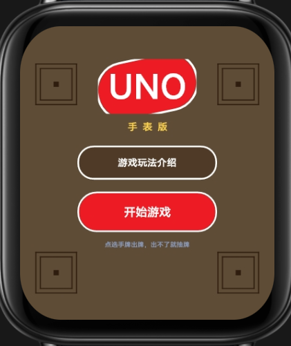
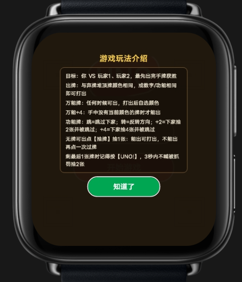
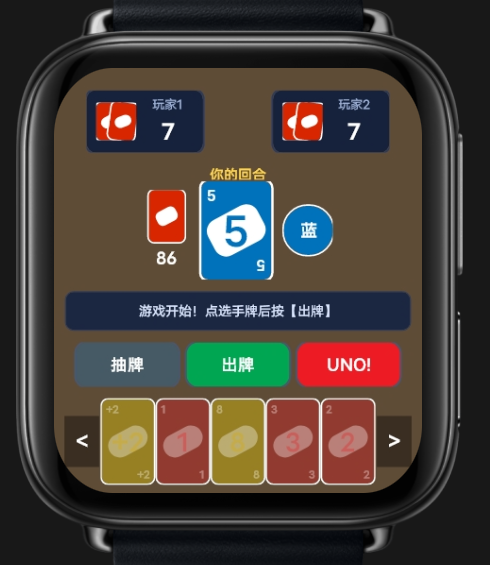
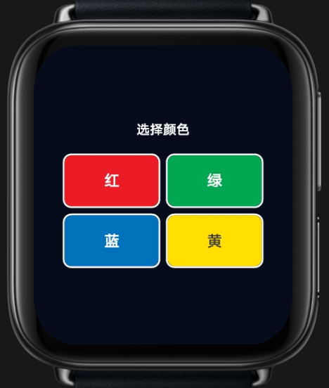

# UNO 手表版

UNO 是一款运行在 vivo BlueOS 智能手表上的卡牌游戏，适配圆屏和方屏设备。

## 下载

下载 [UNO 手表版 RPK 安装包](UNO-watch-v1.0.0.rpk)。仓库提供编译后的应用包，不包含游戏源代码。

## 游戏截图

| 首页 | 玩法说明 |
| --- | --- |
|  |  |

| 游戏画面 | 选择颜色 |
| --- | --- |
|  |  |

## 应用信息

- 包名：`com.demo.unowatch`
- 设备：圆屏、方屏智能手表
- 版本：清单版本 `1.6.0`（原始文件名标注 `1.0.0`）
